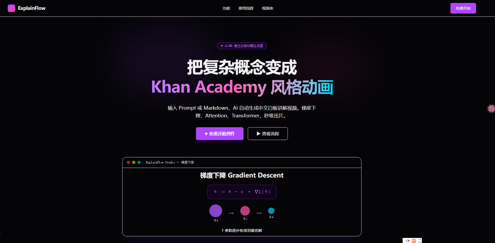
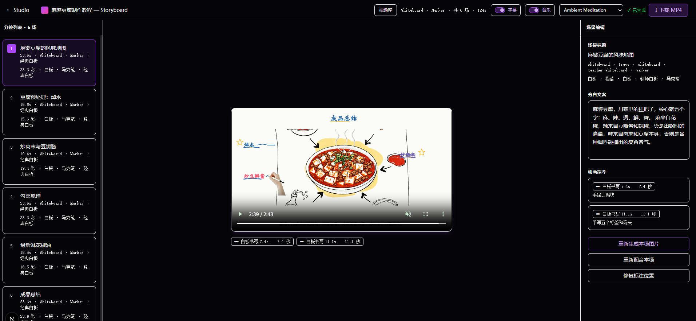

# ExplainFlow

ExplainFlow 是一个本地化教学视频生成工具。目标是把用户输入的主题、讲解要求或参考图，生成带旁白、板书节奏、手写/标注过程和最终 MP4 输出的白板讲解视频。






## 当前状态

- MVP 主链路已打通：主题输入 -> 讲解规划 -> Storyboard -> TTS -> Remotion 代码生成 -> MP4 渲染，全链路本地运行。
- **教学深度契约**：how-to/操作类主题按真实操作顺序“一步一景”编排（最多 12 个短场景），旁白粒度对齐“点哪里、输入什么、看到什么”，专有名词首现大白话解释，默认面向零基础观众。
- **结构化生图提示词**：图像 prompt 采用分段标注式配方（描述 -> 风格句 -> 纸面 -> 色板 -> 负面 -> 生产契约），内置 vivid-storybook / clean-whiteboard / marker-whiteboard / minimal-line-explainer 四种风格；分镜规划自动为整片选择统一风格（导演机制）。
- **图像质量门**：Tesseract OCR 逐词置信度检测，拒绝画面伪文字（覆盖拉丁与西里尔字符）；多概念场景支持 `image_shots` 多分拍独立生成、独立过检后拼合。
- **手绘化管线**：生成图统一经过“中值滤波 + 手抖位移 + 色阶量化”后处理成蜡笔平涂质感；栅格揭示按笔迹长度加权铺满全场景（墨线先、颜色随），全程渐进手绘，结尾定格。
- **场景动画层**：活塞曲柄、相位活塞排、流动箭头、脉冲、循环环五种确定性动效，场景声明 `motion.elements` 即注入。
- 1080p 渲染 + NVENC p4/CQ20 编码；字幕默认开启；edge-tts 神经音色旁白。
- 2026-10-18 完成图像与教学质量整体重构，四个主题（发动机/电动汽车/飞机升力/高铁购票）端到端验证通过。

## 项目结构

```text
apps/
  render/      Remotion 渲染服务，负责 TTS、代码校验、bundle 和 MP4 输出
  web/         Next.js 前端
services/
  api/         FastAPI 服务，负责规划、故事板、旁白和任务编排
evals/         评测脚本与评分说明
outputs/       本地视频输出目录，默认不入库
```

## 模型接入与环境变量

项目从 `.env` 或进程环境读取配置。不要把真实 key 写入文档或提交到仓库。

ExplainFlow 需要接入两类大模型能力，语音合成本地完成：

- 文本规划、Storyboard 和 Remotion 代码生成：使用 OpenAI-compatible Chat API。默认示例是 DeepSeek，`LLM_MODEL` 用于讲解规划，`CODER_MODEL` 用于 Remotion 代码生成。
- 图像生成：使用火山引擎 Ark / Seedream，用于参考图或场景图生成。完整体验建议配置 `ARK_API_KEY`；只跑纯白板矢量链路时可以先不配。
- 语音合成：使用 `edge-tts`，只需要配置 `TTS_VOICE`，不需要额外 API key。
  > **注意**：`edge-tts` 使用的是 Microsoft Edge 浏览器的非官方 Read Aloud 接口，并非 Microsoft 授权的公共 API。在服务器端批量调用存在违反 Microsoft 服务条款的风险，生产或商业部署建议替换为 [Azure Cognitive Services TTS](https://azure.microsoft.com/products/cognitive-services/text-to-speech/)（有免费额度）。

首次启动先复制示例配置：

```powershell
Copy-Item services/api/.env.example services/api/.env
Copy-Item apps/render/.env.example apps/render/.env
Copy-Item apps/web/.env.local.example apps/web/.env.local
```

macOS / Linux 可使用：

```bash
cp services/api/.env.example services/api/.env
cp apps/render/.env.example apps/render/.env
cp apps/web/.env.local.example apps/web/.env.local
```

### `services/api/.env`

后端负责大模型调用、规划、分镜和旁白。默认配置如下，换供应商时只要保证接口兼容 OpenAI Chat API，并同步修改 `OPENAI_BASE_URL`、`LLM_MODEL` 和 `CODER_MODEL`：

```env
OPENAI_API_KEY=your-deepseek-or-openai-compatible-key
OPENAI_BASE_URL=https://api.deepseek.com/v1
LLM_MODEL=deepseek-chat
CODER_MODEL=deepseek-coder

# Local Flux image generation (default)
IMAGEGEN_PROVIDER=local
LOCAL_IMAGEGEN_RUNTIME=D:\ck\stable-diffusion-cpp-bin\vulkan\sd-cli.exe
LOCAL_IMAGEGEN_MODEL=E:\MYLLM\flux1-schnell-fp8\gguf\flux1-schnell-Q5_K_S.gguf
LOCAL_IMAGEGEN_VAE=E:\MYLLM\flux1-schnell-fp8\extracted\vae\diffusion_pytorch_model.safetensors
LOCAL_IMAGEGEN_CLIP_L=E:\MYLLM\flux1-schnell-fp8\extracted\clip\clip-text-model.safetensors
LOCAL_IMAGEGEN_T5XXL=E:\MYLLM\flux1-schnell-fp8\extracted\t5\t5xxl-relative-q8_0.gguf
LOCAL_IMAGEGEN_BACKEND=diffusion=Vulkan0,te=cpu,vae=vulkan
LOCAL_IMAGEGEN_WIDTH=1024
LOCAL_IMAGEGEN_HEIGHT=1024
LOCAL_IMAGEGEN_PREVIEW_WIDTH=512
LOCAL_IMAGEGEN_PREVIEW_HEIGHT=512
LOCAL_IMAGEGEN_STEPS=4
LOCAL_IMAGEGEN_MAX_ATTEMPTS=4

# Optional Ark provider: IMAGEGEN_PROVIDER=ark or local_then_ark
ARK_API_KEY=your-volcengine-ark-key
ARK_BASE_URL=https://ark.cn-beijing.volces.com/api/v3
SEEDREAM_MODEL=doubao-seedream-5-0-260128

TTS_VOICE=zh-CN-XiaoxiaoNeural
CORS_ALLOWED_ORIGINS=http://localhost:3010,http://127.0.0.1:3010
API_HOST=0.0.0.0
API_PORT=8010
LOG_LEVEL=INFO
```

注意图像生成变量名以当前代码为准：使用 `ARK_BASE_URL` 和 `SEEDREAM_MODEL`。

### `apps/web/.env.local`

前端只需要知道 API 服务和渲染服务地址：

```env
NEXT_PUBLIC_API_URL=http://localhost:8010
NEXT_PUBLIC_RENDER_URL=http://localhost:3002
PORT=3010
```

### `apps/render/.env`

渲染服务负责 TTS、Remotion bundle、MP4 渲染和下载。Chrome / Chromium / Edge、ffmpeg 和字体路径会自动探测，通常不用手写本机绝对路径：

```env
RENDER_PORT=3002
PYTHON_API_URL=http://localhost:8010

# 1080p 渲染（不配置时默认 960x540）
REMOTION_WIDTH=1920
REMOTION_HEIGHT=1080
# 场景参考图素材上限（像素，多分拍横幅需要更大值）
REMOTION_RASTER_REVEAL_ASSET_MAX_SIZE=2048

# 通常留空，服务会自动探测 Playwright / Chrome / Chromium / Edge。
# REMOTION_BROWSER_EXECUTABLE=/absolute/path/to/chrome-or-chromium
# REMOTION_CHROME_HEADLESS_SHELL=/absolute/path/to/chrome-headless-shell

# 相对路径会按仓库根目录解析，避免写死 C:/Users/... 这类本机路径。
# EXPLAINFLOW_OUTPUT_DIR=outputs
# EXPLAINFLOW_MUSIC_DIR=outputs/music
# EXPLAINFLOW_RENDER_GENERATED_DIR=apps/render/generated

# ffmpeg / ffprobe 已在 PATH 时不用配置。
# FFMPEG_PATH=/absolute/path/to/ffmpeg
# FFPROBE_PATH=/absolute/path/to/ffprobe
```

## 本地启动

启动 API：

```powershell
cd services/api
uv run uvicorn main:app --host 127.0.0.1 --port 8010
```

启动渲染服务：

```powershell
cd apps/render
node server.mjs
```

启动前端：

```powershell
cd apps/web
npm run dev
```

## 验证命令

```powershell
python -m compileall services/api/main.py services/api/src
node --check apps/render/server.mjs
```

## 版权与许可证

ExplainFlow 以 MIT License 开源，详见 [LICENSE](LICENSE)。

第三方依赖、字体、模板素材和随仓库发布的二进制资产说明见
[THIRD_PARTY_NOTICES.md](THIRD_PARTY_NOTICES.md)。

## 最近进展

2026-10-18 图像与教学质量整体重构（详见 git log）：

- 生图提速 3.9 倍：VAE 解码移至 GPU（`vae=vulkan`），单张 72s -> 18s。
- 渲染升级 1080p：NVENC p4/CQ20，参考图素材上限 2048px，动画线宽随分辨率缩放。
- 生图提示词重构：移植 whiteboard-video-engine 的分段标注式风格配方，LLM 不可控的巨型模板 prompt 退役。
- 图像质量门：Tesseract 逐词置信度 + 西里尔字符覆盖，高置信短词（如 GAS/Safe）也会被拒。
- 多分拍合成（`image_shots`）与 OpenMoji/lucide 图标库路径（`image_icons`）两条可选视觉支线。
- 手绘化后处理（中值+手抖+色阶量化）与栅格揭示节奏重排：从空白板渐进手绘铺满全场景。
- 场景动画层（`motion.elements`）：活塞曲柄/相位活塞排/流动箭头/脉冲/循环环。
- 教学深度契约：概念图与分镜双层约束 how-to 主题“一步一景”，场景上限 7 -> 12，概念图节点去重。
- start.bat 启动失败修复：stop 脚本现在能杀掉 `--reload` 监督者与孤儿 worker，端口循环回收。
- 清理历史产物：仅保留每个主题最终验证版视频。

2026-05-22 完成渲染链路冒烟和清理：

- 用 `What is Machine Learning` 跑通 Graph -> Storyboard -> Remotion code -> Render -> QA -> Download。
- 修复 `gen_test.py` 进度显示单位，避免把 `0-100` 百分数再次按百分比格式化成 `10000%`。
- 修复渲染 QA 的时长判断，改为使用最终 Remotion composition 期望时长。
- 修复渲染服务下载路径缺少 `createReadStream` 导入的问题。
- 修复 planner timing 模块缺少 `_trim_text_to_chars` 导入的问题。
- 增加 required labels 旁白兜底，让关键画面标签进入 TTS 文案。
- 清理本轮临时 MP4、抽帧图片、后台日志、生成目录、`outputs` 评测产物、`evidence` 参考帧、旧中文说明文件和 Python 缓存。
- 删除不再保留的 `docs/` 与 `discuss/` 文档目录。

2026-05-19 完成了一轮白板质量修复：

- 移除了普通白板图形背后的纸片感底影。
- 禁止生成代码使用阴影、滤镜、渐变和内层纸面。
- 通用问题解决框架改为确定性 5 场景。
- 把裸露勾选符号改成有标签的轻松提示，例如“有谱”“别慌”“下一步”。
- 清理 `.tmp` 临时日志、e2e 中间产物和抽帧图片，并将 `.tmp/` 加入忽略列表。
